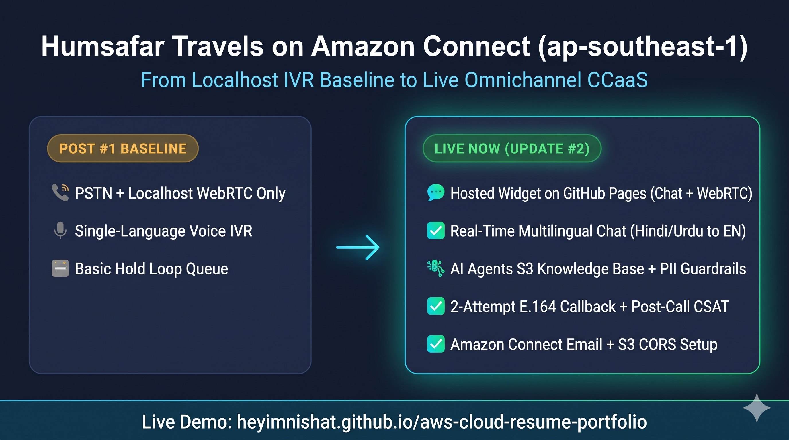

# Humsafar Travels — Omnichannel Amazon Connect CCaaS Lab

-orange?logo=amazonaws)


An end-to-end, production-style omnichannel contact center built on **Amazon Connect (`ap-southeast-1`)** combining Voice IVR, hosted WebRTC calling, real-time multilingual chat translation, Generative AI Knowledge Base (S3 + KMS), inbound Email, and post-call CSAT analytics.

> **Live Demo (24/7):** [Try the Chat & WebRTC Widget on my Cloud Resume Portfolio](https://heyimnishat.github.io/aws-cloud-resume-portfolio/)

---

## Live Architecture



---

## Test It Yourself (30 Seconds)

* **AI Chat + Real-Time Multilingual Translation (Free, 24/7):**
  1. Open [heyimnishat.github.io/aws-cloud-resume-portfolio](https://heyimnishat.github.io/aws-cloud-resume-portfolio/) and click the bottom-right chat widget.
  2. Ask any question about Nishat's AWS/CCaaS background in **English, Hindi, or Urdu** (e.g., *"निशात कहाँ रहता है?"* or *"What AWS skills does Nishat have?"*).
  3. Try intent routing by typing **`password reset`** or **`talk to an agent`**.
* **PSTN Voice IVR:** Dial **`+1 825-402-8327`** *(international call charges may apply; test VIP PIN: `1111` or `2468`)*.

---

## What's Implemented & Tested

| Layer | Components Built | Status |
| :--- | :--- | :--- |
| **Entry Channels** | PSTN DID, Hosted Communications Widget (Chat + WebRTC Voice on GitHub Pages), Inbound Email | Live |
| **Core Routing** | Channel-aware `Humsafar_MainFlowNew` (`CHAT` vs `VOICE`), VIP PIN Lambda validation, Business Hours (`Check OOO`) | Live |
| **Multilingual Chat** | In-flight `UpdateContactMediaProcessing` Lambda (`HumsafarTravels-ChatTranslationProcessor`) translating customer chat to English | Live |
| **Generative AI & Lex V2** | `HumsafarTravelsBot` (`ResumeKBIntent`, `PasswordReset`, `Sales`, `Talk2Agent`), Connect AI Agents, S3 Knowledge Base (Customer-Managed KMS), custom `SelfServiceAnswerGeneration` prompt + PII guardrails | Live |
| **Queues & Surveys** | 2-attempt E.164 callback retry loop (`Humsafar_CustomerQueueFlow`), Markdown password reset link for Chat, Post-Call CSAT/FCR disconnect flow | Live |
| **Email Channel** | `Humsafar_EmailFlow` routing to `Talk2Agent`, S3 CORS-enabled email message bucket, Agent Workspace handling *(outbound in SES Sandbox)* | Live (Lab) |

---

## Key Engineering Lessons Learned

* **Two-block sequence for Chat Analytics + Translation:** In Amazon Connect, `Set message processing` (in-flight translation Lambda) and `Set recording and analytics behavior` (Contact Lens) cannot be combined into a single block—they must run sequentially on the `CHAT` branch only to avoid `Channel mismatch` errors on Voice calls.
* **S3 CORS for Email bodies:** Even with email attachments disabled, Agent Workspace fetches email message bodies directly from S3 and requires an explicit CORS policy on the instance's email storage bucket.
* **Custom AI Prompts & PII Guardrails:** Connect AI Agents block personal URLs/contacts by default; customizing a copied `SelfServiceAnswerGeneration` prompt allows sharing public portfolio/LinkedIn URLs while keeping personal phone numbers blocked.

---

## Planned Repository Structure

```text
humsafar-amazon-connect-ccaas/
├── docs/
│   └── architecture/       # Current & target architecture diagrams
├── flows/                  # Sanitized Amazon Connect flow JSON exports (uploading incrementally)
├── lambda/                 # VIP PIN, Callback, PWD Reset & Chat Translation functions
├── lex/                    # HumsafarTravelsBot schema & locale exports
├── ai-prompts/             # Custom SelfServiceAnswerGeneration YAML prompt
└── terraform/              # Upcoming IaC + CI/CD rebuild
